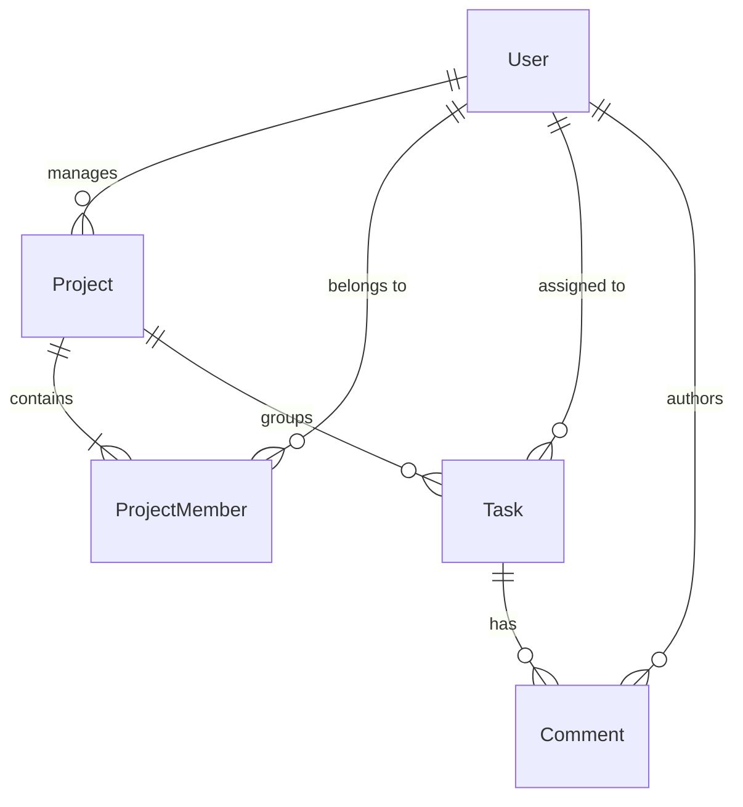

# CollabFlow — Collaborative Project Management Platform

A full-stack, enterprise-grade Collaborative Project Management Platform built using the **MERN Stack** (MongoDB, Express.js, React, Node.js) with Tailwind CSS, JWT authentication with HTTP-only cookies, robust role-based server-side authorization, and **Optimistic Concurrency Control (OCC)** on task mutations.

---

## 1. Project Overview

CollabFlow is engineered for cross-functional engineering and product teams to plan, track, and execute software projects in real-time. It eliminates silent overwrite data loss in multi-user environments through atomic version-checked updates, provides multi-tier role authorization, dynamic project progress calculations based on live MongoDB task states, and a Kanban board and table view.

### Key Capabilities

- **Real Database Persistence:** Persistent storage using local MongoDB with relational schema design via Mongoose.
- **Optimistic Concurrency Control (OCC):** Every task document has an atomic `version` field. Stale client updates trigger `HTTP 409 Conflict`, accompanied by a visual comparison modal showing server-saved state vs. unsaved user edits.
- **Server-Side Authorization:** Enforced strictly in Express middleware; four global roles (`admin`, `project_manager`, `team_member`, `viewer`) and project-level permissions (`manager`, `member`, `viewer`).
- **Interactive Kanban & Table Views:** Dual task workspace with real-time drag/status transitions, priority badges, filters, search, and assignee assignment guards.
- **Task Discussion Threads:** Full commenting system with author attribution and deletion permissions.
- **User Administration:** Admin-only console for account creation, global role modifications, and account deactivation safeguards.
- **One-Click Demo Switcher:** Top navigation demo bar allows instant switching between Admin, PM, Team Member, and Viewer accounts to demonstrate access control to hackathon judges.

---

## 2. Technology Stack

### Backend
- **Runtime:** Node.js (v22.18.0) ES Modules (`"type": "module"`)
- **Web Framework:** Express.js 4.x
- **Database Engine:** MongoDB (v8.2.2) via Mongoose 8.x
- **Security:** `helmet` for secure HTTP headers, `cors` with credentials, `cookie-parser`
- **Authentication:** `jsonwebtoken` (JWT) in HTTP-only cookies + Bearer token support
- **Cryptography:** `bcryptjs` with salt rounds = 10
- **Validation:** `express-validator` middleware
- **Testing:** Node.js native test runner (`node --test`) and Supertest

### Frontend
- **Framework:** React 18
- **Tooling & Bundler:** Vite 6
- **Styling:** Tailwind CSS 3.4 with custom palettes and responsive layout
- **Icons:** Lucide React
- **Routing:** React Router DOM 6
- **HTTP Client:** Axios with centralized interceptors
- **State Management:** React Context API (`AuthContext`) and custom hooks
- **Code Quality:** ESLint 9

---

## 3. Project Directory Structure

```text
mern-starter/
├── backend/
│   ├── config/
│   │   └── db.js                        
│   ├── model/
│   │   ├── User.js                      
│   │   ├── Project.js                   
│   │   ├── ProjectMember.js             
│   │   ├── Task.js                      
│   │   └── Comment.js                   
│   ├── control/
│   │   ├── auth.controller.js           
│   │   ├── user.controller.js           
│   │   ├── project.controller.js        
│   │   ├── projectMember.controller.js  
│   │   ├── task.controller.js           
│   │   └── comment.controller.js        
│   ├── routes/
│   │   ├── auth.routes.js
│   │   ├── user.routes.js
│   │   ├── project.routes.js
│   │   ├── task.routes.js
│   │   ├── comment.routes.js
│   │   └── health.routes.js
│   ├── middleware/
│   │   ├── auth.middleware.js        
│   │   ├── role.middleware.js           
│   │   ├── validate.middleware.js      
│   │   └── error.middleware.js          
│   ├── utils/
│   │   └── jwt.js                       
│   ├── tests/
│   │   └── api.test.js                
│   ├── app.js                           
│   ├── server.js                        
│   ├── seed.js                          
│   ├── package.json
│   ├── .env.example
│   └── .gitignore
├── frontend/
│   └── view/
│       ├── src/
│       │   ├── apis/                    # Centralized Axios client & API endpoints
│       │   ├── components/
│       │   │   └── common/              # Button, Input, Select, Modal, ConfirmDialog, ConflictModal, etc.
│       │   ├── context/
│       │   │   └── AuthContext.jsx      # Session restoration, login, logout, roles
│       │   ├── layouts/
│       │   │   ├── DashboardLayout.jsx  # Main app shell
│       │   │   ├── Navbar.jsx           # Topbar with Judge One-Click Demo Switcher
│       │   │   └── Sidebar.jsx          # Role-aware responsive navigation
│       │   ├── pages/
│       │   │   ├── LoginPage.jsx
│       │   │   ├── DashboardPage.jsx
│       │   │   ├── ProjectsPage.jsx
│       │   │   ├── ProjectDetailPage.jsx
│       │   │   ├── ProjectTasksPage.jsx 
│       │   │   ├── ProjectTeamPage.jsx  
│       │   │   ├── TaskDetailPage.jsx   
│       │   │   ├── UsersPage.jsx        
│       │   │   ├── ProfilePage.jsx      
│       │   │   └── NotFoundPage.jsx
│       │   ├── routes/
│       │   │   ├── AppRoutes.jsx
│       │   │   ├── ProtectedRoute.jsx
│       │   │   └── RoleGuard.jsx
│       │   ├── App.jsx
│       │   ├── main.jsx
│       │   └── index.css
│       ├── index.html
│       ├── vite.config.js
│       ├── tailwind.config.js
│       ├── postcss.config.js
│       ├── package.json
│       ├── eslint.config.js
│       └── .env.example
├── .gitignore
└── README.md
```

---

## 4. Database Models & Schema Relationships



1. **User:** `name`, `email` (unique, lowercase), `passwordHash` (bcrypt), `role` (`admin`, `project_manager`, `team_member`, `viewer`), `isActive`.
2. **Project:** `name`, `description`, `status` (`active`, `archived`), `manager` (Ref: User), `createdBy` (Ref: User), `timestamps`.
3. **ProjectMember:** `project` (Ref: Project), `user` (Ref: User), `role` (`manager`, `member`, `viewer`), `joinedAt`. Compound unique index on `{ project: 1, user: 1 }`.
4. **Task:** `title`, `description`, `project` (Ref: Project), `assignedTo` (Ref: User or null), `status` (`todo`, `in_progress`, `done`), `priority` (`low`, `medium`, `high`), `dueDate`, `createdBy` (Ref: User), `version` (Numeric, default: 1).
5. **Comment:** `task` (Ref: Task), `author` (Ref: User), `content`, `timestamps`.

---

## 5. User Roles and Permission Matrix

| Action / Capability | Admin | Project Manager | Team Member | Viewer |
| :--- | :---: | :---: | :---: | :---: |
| Access Dashboard & Metrics | Yes | Yes | Yes | Yes |
| View Accessible Projects | All Projects | Managed/Member | Member Projects | Member Projects |
| Create Projects | Yes | Yes | No | No |
| Edit Project Information | Yes | Yes (Managed) | No | No |
| Archive / Restore Projects | Yes | Yes (Managed) | No | No |
| Manage Project Team (Add/Remove) | Yes | Yes (Managed) | No | No |
| Create Tasks | Yes | Yes | No | No |
| Edit Any Task in Project | Yes | Yes (Managed) | No | No |
| Edit Assigned Task (Status/Details) | Yes | Yes | Yes (Assigned) | No |
| Reassign Task Assignees | Yes | Yes (Managed) | No | No |
| Delete Tasks | Yes | Yes (Managed) | No | No |
| Post Comments | Yes | Yes | Yes | No (Read-only) |
| Delete Comments | Yes | Yes (Project) | Own Comments | No |
| User Administration (Create, Role, Status) | Yes | No | No | No |
| Edit Personal Profile & Password | Yes | Yes | Yes | Yes |

---

## 6. Optimistic Concurrency Control (OCC)

To prevent race conditions where two concurrent users edit the same task and silently overwrite each other's changes:

1. **Version Tracking:** Every Task document has an integer `version` field initialized to `1`.
2. **Client Submission:** The frontend always includes the expected task `version` in any update mutation (`PATCH /api/tasks/:id`, `PATCH /api/tasks/:id/status`, `PATCH /api/tasks/:id/assignee`).
3. **Atomic MongoDB Mutation:**
   ```javascript
   const updatedTask = await Task.findOneAndUpdate(
     { _id: taskId, version: expectedVersion },
     {
       $set: updateFields,
       $inc: { version: 1 }
     },
     { new: true, runValidators: true }
   );
   ```
4. **Conflict Response:** If the query matches 0 documents because another user updated the version:
   - The backend returns `HTTP 409 Conflict` with `{ conflict: true, expectedVersion, currentVersion, latestTask }`.
   - The frontend intercepts the 409 error and displays the **Concurrent Edit Conflict Modal**.
   - The modal contrasts the latest saved database state with the user's unsaved draft and provides an explicit "Load Latest Data" button.

---

## 7. API Reference Endpoints

Base URL: `http://localhost:5000/api`

### Health & Readiness
- `GET /api/health` — Service uptime & system status
- `GET /api/ready` — MongoDB active connection check (returns 200 or 503)
- `GET /api/test` — Endpoint echo check

### Authentication
- `POST /api/auth/login` — Authenticate email & password, sets HTTP-only cookie
- `POST /api/auth/logout` — Clears authentication cookie
- `GET /api/auth/me` — Fetches current authenticated user profile

### User Administration (Admin Only)
- `GET /api/users` — Paginated list of users (supports `page`, `limit`, `search`, `role`, `isActive`)
- `POST /api/users` — Create user with hashed credentials and assigned role
- `GET /api/users/:id` — View specific user details
- `PATCH /api/users/:id` — Update user details (Admin or self)
- `PATCH /api/users/:id/status` — Deactivate / reactivate user (safeguard against last admin)

### Projects
- `GET /api/projects` — Filter projects by `status` (active/archived), `search`, with computed metrics
- `POST /api/projects` — Create project (Admin or Project Manager)
- `GET /api/projects/:id` — View project overview, manager, and task completion percentages
- `PATCH /api/projects/:id` — Edit project title, description, or manager
- `PATCH /api/projects/:id/archive` — Toggle between active and archived

### Project Membership
- `GET /api/projects/:id/team` — List project team members and assigned roles
- `POST /api/projects/:id/team` — Add active user to project
- `PATCH /api/projects/:id/team/:userId` — Change member role (with final manager demotion guard)
- `DELETE /api/projects/:id/team/:userId` — Remove member (safeguard against lead manager)

### Tasks (with Optimistic Concurrency)
- `GET /api/projects/:id/tasks` — List tasks for project (`status`, `priority`, `assignedTo`, `search`)
- `POST /api/projects/:id/tasks` — Create task (validates assignee is active project member)
- `GET /api/tasks/:id` — View task details
- `PATCH /api/tasks/:id` — Atomic update with version validation (returns 409 on version mismatch)
- `PATCH /api/tasks/:id/status` — Quick status transition with version validation
- `PATCH /api/tasks/:id/assignee` — Reassign task with version validation
- `DELETE /api/tasks/:id` — Delete task (Manager or Admin)

### Comments
- `GET /api/tasks/:id/comments` — List comments for task
- `POST /api/tasks/:id/comments` — Add comment to task (Members, PM, Admin)
- `DELETE /api/comments/:id` — Delete comment (Author, PM, Admin)

---

## 8. Local Setup & Reproduction Instructions

### Prerequisites
- **Node.js:** v18+ (tested on Node v22.18.0)
- **MongoDB:** Local MongoDB Community Server v6+ or v8+ running on `127.0.0.1:27017`

### Step 1: Ensure MongoDB is Running
Start your local MongoDB daemon:
```powershell
mongod --port 27017
```
Verify MongoDB connectivity:
```powershell
Test-NetConnection -ComputerName 127.0.0.1 -Port 27017
```

### Step 2: Configure Environment Variables

**Backend (`backend/.env`):**
```env
PORT=5000
NODE_ENV=development
MONGODB_URI=mongodb://127.0.0.1:27017/collab_project_manager
JWT_SECRET=supersecretjwtkey_collabflow_hackathon_2026_dev
JWT_EXPIRES_IN=1d
CLIENT_URL=http://localhost:5173
```

**Frontend (`frontend/view/.env`):**
```env
VITE_API_BASE_URL=http://localhost:5000/api
```

### Step 3: Install Dependencies
```bash
# Backend dependencies
cd backend
npm install

# Frontend dependencies
cd ../frontend/view
npm install
```

### Step 4: Seed Database with Demo Records
Run the idempotent seed script to populate users, projects, memberships, tasks, and comments:
```bash
cd backend
npm run seed
```

### Step 5: Start the Backend Server
```bash
cd backend
npm start
# Server listens at http://localhost:5000
```

### Step 6: Start the Frontend Application
In a separate terminal:
```bash
cd frontend/view
npm run dev
# Frontend runs at http://localhost:5173
```

---

## 9. Demo Credentials

| Role | Email | Password | Permissions Summary |
| :--- | :--- | :--- | :--- |
| **Admin** | `admin@collabflow.dev` | `Password@123` | Full control: user management, all projects, task management |
| **Project Manager** | `pm@collabflow.dev` | `Password@123` | Project lead: create projects, manage team, create/assign tasks |
| **Team Member 1** | `dev1@collabflow.dev` | `Password@123` | Assigned tasks: update status/details of assigned tasks, comments |
| **Team Member 2** | `dev2@collabflow.dev` | `Password@123` | Assigned tasks: update status/details of assigned tasks, comments |
| **Viewer** | `viewer@collabflow.dev` | `Password@123` | Read-only: view projects, tasks, comments, cannot mutate |

> **Pro-Tip for Evaluators:** The top navigation bar includes a **Demo Switch** pill allowing 1-click switching between any role without needing to re-type passwords!

---

## 10. Automated Testing

Run the automated integration test suite covering health, auth, role gates, project CRUD, assignment validation, and optimistic concurrency conflicts:

```bash
cd backend
npm test
```

### Test Results
```text
✔ 1. GET /api/health should return ok status
✔ 2. GET /api/ready should report database connection
✔ 3. POST /api/auth/login with valid credentials succeeds and returns user info
✔ 4. POST /api/auth/login with invalid password is rejected
✔ 5. Protected endpoints reject unauthenticated requests
✔ 6. Admin can fetch users list; non-admin is forbidden
✔ 7. Project creation by PM succeeds and sets up manager membership
✔ 8. Duplicate project membership is rejected
✔ 9. Viewer cannot create tasks or modify project
✔ 10. PM can create and assign task to active project member
✔ 11. Rejects task assignment to user not in project
✔ 12. Member can add comment to authorized task
✔ 13. Inactive user is rejected on authenticated routes
✔ 14. Valid update increments task version from 1 to 2
✔ 15. Stale task update returns HTTP 409 Conflict and protects data integrity

15 passed, 0 failed
```

---

## 11. Production Build Verification

Build the production-ready frontend bundle:
```bash
cd frontend/view
npm run build
```
Result: Bundles cleanly to `frontend/view/dist/` in ~7s with 0 warnings or errors.

---

## 12. Git Commit Workflow

```bash
git status
git add .
git commit -m "feat: complete CollabFlow collaborative project management platform"
```
